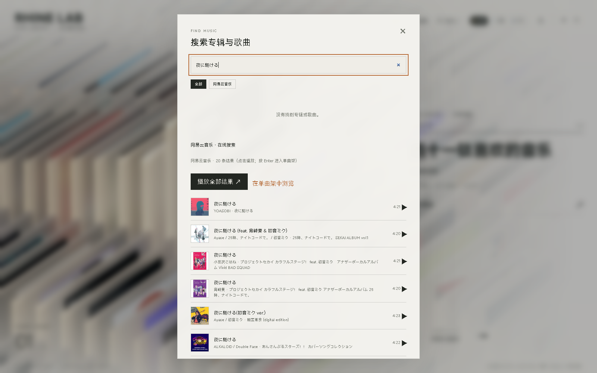
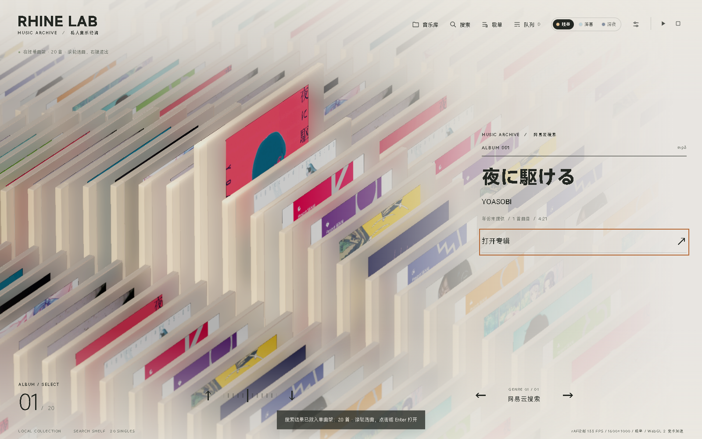
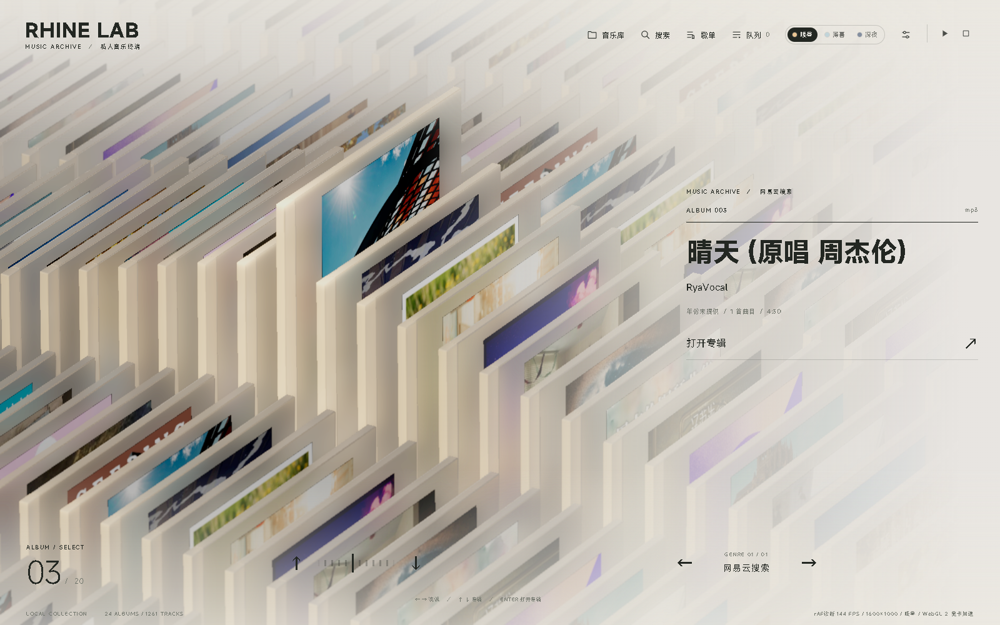
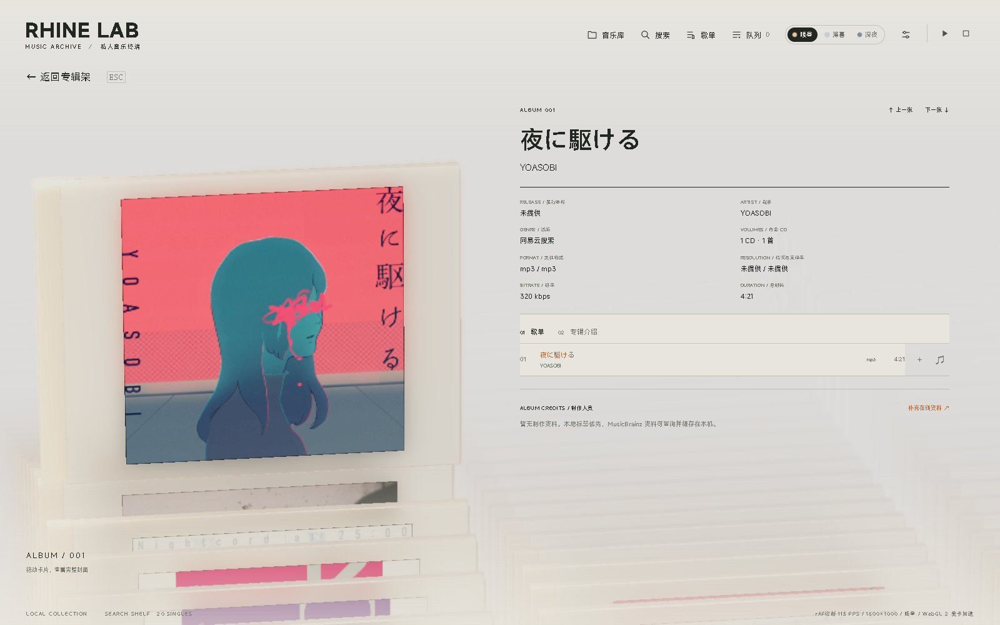

# Rhine Music · Windows（网易云音乐深度定制版）

> 本项目是 [Bong712/Rhine-Music-Windows](https://github.com/Bong712/Rhine-Music-Windows) 的社区二次开发版，在原有三维音乐档案界面与本地播放基础上，接入了网易云音乐账号的歌单/收藏、在线搜索与单曲架等能力。非网易官方产品。
>
> A third-party NetEase Cloud Music player with a RHINE LAB terminal-inspired 3D interface.

**当前版本：0.6.0-dev.83**

---

## 上游与署名（请先阅读）

本项目站在以下项目与作者的工作之上，代码与创意署名如下，感谢他们的开源与创作：

| 上游 / 参考 | 作者 | 本项目中的关系 | 链接 |
| --- | --- | --- | --- |
| **RhineLabUI** | **@路北路陈（LBEILC）** | 三维档案界面、渲染与动效基础（MIT） | <https://github.com/LBEILC/RhineLabUI> |
| **UI 概念参考视频** | **@Ronald没有魔杖** | 本界面风格的创作参考与灵感来源 | <https://www.bilibili.com/video/BV1XBaK6pECN/?spm_id_from=333.1387.homepage.video_card.click&vd_source=da40ab32db7ab4df771e94bfea6163b3> |
| Rhine-Music-Demo | @RonaldDeng | 音乐库与播放服务、专辑模型、音乐界面（MIT） | <https://github.com/RonaldDeng/Rhine-Music-Demo> |
| Rhine-Music-Windows | @Bong712 | Windows 桌面宿主、WebView2 + 内置 Node 服务、打包方案（MIT）；本仓库的代码基点 | <https://github.com/Bong712/Rhine-Music-Windows> |

视觉概念来源于《明日方舟》特别映像「莱茵生命：访问」，相关作品、名称、标志、设定、原 PV 及声音的权利归相应权利人（鹰角网络等）所有。本项目是非官方、非商业的爱好者工程，与官方及网易云音乐均无隶属或授权关系。

代码按 [MIT License](LICENSE) 授权，保留上述作者署名；MIT 不自动覆盖原作模型、图标、字体、音频采样等非代码素材，详见 [NOTICE.md](NOTICE.md) 与 [THIRD-PARTY-NOTICES.md](THIRD-PARTY-NOTICES.md)。

---

## 本仓库相对上游新增的功能

- **网易云账号接入**：读取本机网易云音乐客户端的登录态（本地 cookie，仅在本机使用），把「我喜欢的音乐」和全部歌单映射成三维专辑架上的卡片，和本地曲库合并展示。
- **在线搜索**：搜索面板同时搜索本地曲库与网易云在线曲库；在线结果自动补全封面、歌手、专辑与时长。
- **在线单曲架**：输入关键词按 Enter 后，在线搜索结果铺成单曲架（每首歌一张卡片），滚轮选曲、点击/Enter 打开单曲。
- **播放联动封面**：在专辑详情里点播任意一首歌，左侧 3D 卡片切换成这首歌自己的封面；切歌时同步更新。
- **内嵌完整歌词**：专辑详情右侧内嵌同步滚动歌词（固定歌名/歌手、居中大字、隐藏滚动条）。
- **更清爽的交互**：取消启动进场动画，直接进入专辑架；右键逐级返回；滚轮切换专辑。
- **默认封面**：专辑/歌曲没有封面或封面加载失败时，使用内置默认图（随程序打包），不再显示“暂无专辑封面”。

## 截图

| 在线搜索 | 单曲架 |
| --- | --- |
|  |  |

| 单曲架·滚轮选曲 | 单曲详情 |
| --- | --- |
|  |  |

## 环境要求

### 运行（普通用户 / 拿到 exe 直接用）

| 项目 | 要求 | 说明 |
| --- | --- | --- |
| 操作系统 | Windows 10 / 11 x64 | WinForms + WebView2 桌面程序，不支持 macOS / Linux |
| WebView2 Runtime | Microsoft Edge WebView2 Evergreen Runtime | Win11 与已更新的 Win10 一般自带；缺失时程序会提示，去微软官网装一次即可 |
| .NET Framework | 4.6.2 及以上（x64） | Win10/11 系统自带 4.8，**无需另外安装** |
| Node.js | **不需要** | 运行所需的 node.exe 已打包进 exe，内部音乐服务只监听 127.0.0.1 |
| 显卡 | 支持 WebGL 2 的 GPU（集显也可） | 三维界面依赖 WebGL2；帧率取决于显卡/驱动/显示器 |
| 网络 | 可选 | 本地曲库播放不需要联网；网易云歌单、在线搜索、封面/歌词需要联网 |
| 网易云客户端 | 可选（要用网易云功能时必需） | 本机安装并登录网易云音乐客户端；程序只读取其本地登录态，不上传账号 |
| 磁盘空间 | 约 250 MB 起 | 首次运行解压约 70–100 MB 程序资源到 `%LOCALAPPDATA%\Rhine Music`，另加曲库索引与封面缓存 |
| 权限 | 普通用户即可 | 建议放在普通目录（如 `D:\RhineMusic`）运行，不要放在系统保护目录或受限沙箱目录 |

发布出来的 exe 是**单文件自解压程序**：别人不需要安装 Node.js、npm、.NET SDK 或任何运行库；双击后自动解压、启动。

### 构建（想自己编译）

| 项目 | 要求 |
| --- | --- |
| 操作系统 | Windows 10/11 x64 |
| Node.js | 22.12+（推荐 24 LTS）与 npm |
| PowerShell | PowerShell 7（`pwsh`），构建脚本使用 7 语法 |
| .NET | .NET Framework 4.6.2+ x64 编译工具（`csc.exe`） |
| WebView2 SDK | 仓库已包含 `sdk/lib`，无需另外下载 |
| 网络 | `npm ci` 与 `npm run build` 首次需要联网 |
| 磁盘空间 | 约 1 GB（node_modules + dist + 构建产物） |

## 下载与运行

- 系统要求：Windows 10/11 x64，需要 [Microsoft Edge WebView2 Evergreen Runtime](https://developer.microsoft.com/microsoft-edge/webview2/)（大多数系统已自带）。
- 下载 Release 中的 `Rhine-Music-Desktop-<version>.exe`，放到任意普通目录（例如 `D:\RhineMusic`）后双击运行。
- 首次启动会把运行资源解压到 `%LOCALAPPDATA%\Rhine Music\app-v<version>`；你的音乐索引、设置和缓存保存在 `%LOCALAPPDATA%\Rhine Music\music-data-v3`。
- 程序内的音乐服务只监听本机 `127.0.0.1`，不对外提供服务。

### 网易云功能的使用前提

1. 本机安装并登录网易云音乐客户端（Windows 版）；
2. 启动本应用后，它会读取网易云客户端本地的登录 cookie（仅本机读取，不发送到外部）；
3. 打开「音乐库」即可看到网易云歌单；搜索框输入关键词后按 Enter 进入在线单曲架。

如果没有登录态，本地曲库功能仍然可用，网易云相关区块会提示未连接。

## 开发与构建

需要 Windows 10/11、Node.js 22.12+、npm、.NET Framework 4.6.2+ x64 编译环境和 WebView2 Runtime。仓库包含构建所需的 WebView2 SDK 程序集及许可文件。

```powershell
npm ci
$releaseDir = Join-Path (Get-Location) 'outputs'
# 构建前端的 TMP/TEMP 需指向可写目录
$env:TMP = Join-Path (Get-Location) '.tmp'
$env:TEMP = $env:TMP
npm run build
pwsh ./scripts/build-windows.ps1 `
  -NodePath (Get-Command node).Source `
  -WebView2Dir (Join-Path (Get-Location) 'sdk/lib') `
  -RuntimeTemplateDir (Join-Path (Get-Location) 'build-rt') `
  -OutputDirectory $releaseDir
```

`build-rt/` 只需包含 `NODE-LICENSE.txt`（Node.js 的许可文本，随包分发用）；Node 可执行文件由 `-NodePath` 指定。

构建脚本会自动分配新的 `0.6.0-dev.N` 版本，并把 EXE 与版本清单输出到 `outputs/`。前端开发模式可用 `npm run dev`，独立音乐服务可用 `npm run music`。

## 免责声明

- 本项目仅供个人学习与技术交流，**不提供、不分发任何音乐音频或商业专辑封面**；播放内容来自你自己的网易云账号与本机音乐文件。
- 网易云音乐相关服务、内容与商标归网易云音乐及其权利人所有；本项目与网易云音乐无任何隶属关系，也不绕过账号本身的权限。
- 读取网易云客户端 cookie 仅用于本机请求，不会上传到任何第三方服务器；如不放心可随时退出程序并删除 `%LOCALAPPDATA%\Rhine Music`。
- 默认封面图由仓库维护者提供，用于填补缺失封面；如相关权利人认为不妥，请联系删除。
- 使用本项目产生的任何后果由使用者自行承担。

## 第三方许可

- [LICENSE](LICENSE)：MIT
- [NOTICE.md](NOTICE.md)：版权、署名与素材来源
- [THIRD-PARTY-NOTICES.md](THIRD-PARTY-NOTICES.md)：第三方开源库与许可证清单

## English

Rhine Music for Windows is a community fork of [Bong712/Rhine-Music-Windows](https://github.com/Bong712/Rhine-Music-Windows), adding NetEase Cloud Music integration (playlists, online search, a 3D "single shelf", per-track cover switching, inline lyrics) on top of the original 3D music archive UI.

The 3D archive interface builds on [LBEILC/RhineLabUI](https://github.com/LBEILC/RhineLabUI) by **路北路陈 (@LBEILC)**, with UI concept reference from **@Ronald没有魔杖**'s video (<https://www.bilibili.com/video/BV1XBaK6pECN/>), the music adaptation from [RonaldDeng/Rhine-Music-Demo](https://github.com/RonaldDeng/Rhine-Music-Demo), and the Windows port from [Bong712/Rhine-Music-Windows](https://github.com/Bong712/Rhine-Music-Windows). Code is MIT licensed; original visual assets remain the property of their respective owners.
